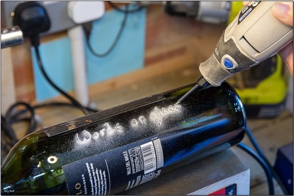

# microsoft word website

*Words on glass — a reminder that "Word" is now as much a browser tab as a desktop window. (Ray Best Through the lens · CC BY)*

People type `microsoft word website` for a handful of reasons, and they rarely mean the same thing. Some want the official page where Word lives. Some want the free browser version and don't know it has a name. Some just want to open a `.docx` without installing anything. This note sorts those apart, because "the Microsoft Word website" is three or four different destinations depending on which one you actually need.

## What "the Word website" actually refers to

There is no single page called "Microsoft Word." Word is one application inside a family, and that family is sold and hosted in a few places:

- **Microsoft 365** — the subscription that includes the desktop Word app, the web app, and the mobile apps. This is what most "download Word" searches are really after.
- **Word for the web** — the free, browser-based editor at Office.com. No install. A Microsoft account is enough.
- **Office.com** — the hub that hosts Word, Excel, PowerPoint and OneDrive in one place. When someone says "the Word website," this is usually the address they want.

The confusion is understandable: Microsoft renamed things repeatedly over the years — Office 365 became Microsoft 365, "Office Online" became "Office for the web," and the marketing pages moved around. If a link you saved in 2019 still works, it probably redirects.

## Word for the web: the free path

Word for the web is the answer for the majority of casual searches. You sign in with a free Microsoft account, open Word in the browser, and start typing. Files save to OneDrive automatically, and you can download a `.docx` or `.pdf` at any point.

What you get for free is genuinely usable: fonts, styles, headings, tables, comments, track changes, and real-time co-editing when you share a link. What you give up compared to the desktop app: some advanced layout tools, certain templates, mail merge, and the heavier automation features.

Two gotchas worth knowing up front:

1. **The free web version is read-and-light-edit on very complex documents.** If a file was built with intricate section breaks or embedded objects, the browser may render it slightly differently. Always check the final PDF before sending something important.
2. **A Microsoft account is not the same as a work account.** If your school or employer gave you a login, sign in with *that* address — the free personal account won't see the shared drive.

*The smallest Gull in the word — a small thing in a big document, which is exactly how a stray typo feels at 2 a.m. (Carlos Eduardo Joos · CC BY)*

## `word pad`, `ms word download`, and other near-misses

Several queries in this space get bundled together even though they point to different tools:

- **WordPad** is not Word. It's a plain rich-text editor that has shipped with Windows for decades, and Microsoft has been phasing it out. It opens `.rtf` and simple `.docx` files but has no collaboration, no cloud save, and no track changes. If you only need to scribble a note, it's fine. If you need to *share* that note, it isn't.
- **"MS Word download"** almost always means the Microsoft 365 installer, which is a paid subscription. There is no legitimate standalone perpetual "Word 2024 download" sold the way Word 2016 once was; the retail boxed era is over. The free route is the browser.
- **`microsoft online`** and **`msword online`** are the same destination spelled two ways: sign in at Office.com and pick Word.

None of these are interchangeable, and mixing them up is the most common source of "why can't I edit this file?" frustration.

## A practical starting checklist

If you arrived here wanting to *use* Word right now, this is the short version:

1. Go to **Office.com** and sign in with a Microsoft account (create one free if needed).
2. Click the **Word** icon. The web editor opens in a new tab.
3. To start from a file you already have, use **Upload** and pick the `.docx` from your computer.
4. Turn on **AutoSave** (top-left toggle) so the document lives in OneDrive and survives a closed tab.
5. When you're done, **File → Save As → Download a Copy** for a local `.docx`, or **Export → PDF** for a fixed-format version.

That sequence covers the overwhelming majority of "I just need to open/edit a Word document" cases without installing anything.

## Why the phrasing varies so much

Search terms like `word+`, `ms word`, `word doc`, and `microsoft word free` are all surface variations of one underlying need: write or edit a document with the tool everyone else is using. The `+` and the extra spaces don't change the subject. What changes is which *edition* the person wants — free web, paid desktop, or the bundled Microsoft 365 subscription.

The honest summary: **Word for the web is free and good enough for most documents; the desktop app is a paid upgrade for heavy formatting and offline work; and "the Microsoft Word website" is really Office.com.** Pick the one that matches your task, not the one that matches the search box.

## Repository purpose

This repo collects notes on the `word+` search cluster — the many ways people type their way toward Microsoft Word online, and what each phrasing actually means. It exists to answer the query `microsoft word website` plainly, without pretending to be an official support page.

---
Photos: Ray Best Through the lens · CC BY by; Carlos Eduardo Joos · CC BY by